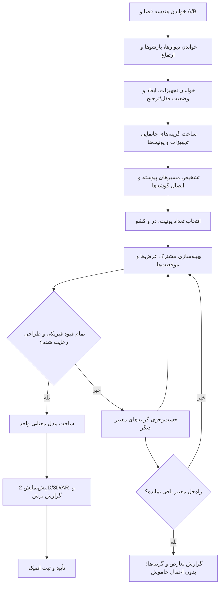

# قرارداد منطق کیچیار — نسخه ۲: حل‌گر یکپارچه طراحی آشپزخانه
آخرین بازبینی بر اساس تصمیم صریح کاربر: ۲۰۲۶-۱۱-۰۱

این سند مرجع واحد طراحی و تغییر کد است. هر تصمیم جدید و صریح کاربر بر نسخه‌های قدیمی‌تر مقدم است. **کیچیار نباید کابینت، در، کشو و تجهیزات را با الگوریتم‌های مستقل و بی‌خبر از یکدیگر طراحی کند؛ کل چیدمان باید یک مسئلهٔ بهینه‌سازی مشترک باشد.**

## تصمیم‌های تکمیلی کاربر — ۲۰۲۶-۱۱-۰۱

- ابعاد کاتالوگ، ابعاد اسمی طراحی هستند و اندازهٔ واقعی مدل انتخابی قابل ویرایش می‌ماند؛ گاز پنج‌شعلهٔ پیش‌فرض ۹۰ سانتی‌متر و سینک پیش‌فرض ۹۰ سانتی‌متر است.
- عرض محدودهٔ کشوهای زیر گاز دقیقاً تابع عرض گاز است؛ فضای باقی‌مانده نباید با بزرگ‌کردن این کشوها جذب شود. این عرض استثنای هدف عمومی ۴۵–۵۵ است.
- برای تعادل درها، تجهیزاتِ بدون قفل، از جمله ماشین‌ها، می‌توانند در محدودهٔ مجاز کمی جابه‌جا شوند. پیش‌نمایش تغییرات و حریم واقعی نصب حفظ شود.
- ویرایش تجهیز فقط ردیف خودش و اجزای مستقیماً وابسته، مانند هود و هوایی متناظر، را بازحل می‌کند. اتصال گوشه مجوز بازچینی ساید دیگر نیست؛ بررسی برخورد می‌تواند مرز ردیف را بخواند.
- سایه‌ها حفظ شوند؛ وضوح بالا اولویت نیست. هزینهٔ رندر و محاسبه باید محدود باشد و روانی روی دستگاه واقعی جداگانه سنجیده شود.
- سایر خواسته‌های همین گفت‌وگو: کنج زمینی/هوایی با برخورد جلو/پشت و در/صفحهٔ متناسب؛ ارتفاع مشترک هوایی؛ یخچال قابل‌شناسایی با کابینت بالایی به عمق زمینی/یخچال و بازشوی بالا؛ بالای سینک دو در افقی مستقل یا جک مشترک، هم‌عرض دو در زیر سینک؛ هود اکسپوز بدون در دکوری؛ فرگاز مستقل بدون یونیت زیر؛ جدایی سمپل مدل از سمپل رنگ؛ جنس و جهت بازشو برای هر یونیت؛ انتخاب با نگه‌داشتن و کادر یونیت؛ قدی حداکثر هم‌تراز بالای هوایی، با تقسیم یک/دو در برای عرض زیر ۵۵ و دو/چهار در برای عرض بیشتر، نمای جلو/کنار و MDF/شیشه/بدون در. ثبت این قواعد به معنی تکمیل پیاده‌سازی نیست.

## ۱. اصل مرکزی

طراح کابینت ابتدا کل دیوار و تجهیزات را می‌بیند، سپس تعداد یونیت‌ها، عرض باکس‌ها، محل تجهیزات و تقسیم درها/کشوها را با هم تنظیم می‌کند. کیچیار هم باید همین کار را انجام دهد.

متغیرهای یک حل مشترک:
- تعداد و عرض یونیت‌های زمینی، هوایی و تمام‌قد؛
- تعداد و عرض درها و جبهه‌های کشو؛
- موقعیت و ابعاد سینک، گاز، هود، یخچال، ماشین ظرفشویی، لباسشویی و فر؛
- محل اتصال یونیت‌ها در گوشه‌ها و امتداد دیوارهای زاویه‌دار؛
- صفحه، پاسنگ و بین‌کابینتی؛
- ترجیحات سبک، رنگ، دستگیره و تقسیم‌بندی عکس مرجع.

هیچ مرحله‌ای نباید خروجی مرحلهٔ قبل را بدون بررسی اثر آن بر بقیهٔ اجزا قطعی فرض کند. حل‌گر باید گزینه‌های معتبر را با هم مقایسه و بهترین ترکیب را انتخاب کند.

## ۲. درخت تصمیم و ترتیب حل

### گام A — فهم فضا
- A/B مرجع متریک و جهت کل پروژه است.
- دیوارها، گوشه‌ها، درها، پنجره‌ها، سقف و ارتفاع واحد خوانده شوند.
- طول مفید هر دیوار پس از کسر بازشوها و موانع محاسبه شود.

### گام B — فهم تجهیزات و ترجیحات
- همهٔ تجهیزات با ابعاد واقعی، حریم نصب و ارتباط‌هایشان وارد حل شوند.
- محل فعلی تجهیز به‌طور پیش‌فرض **موقعیت ترجیحی** است، نه قید مطلق.
- تجهیز فقط وقتی قید سخت مکانی است که کاربر صریحاً آن را قفل کرده باشد.
- در طراحی خودکار، حل‌گر می‌تواند برای رسیدن به چیدمان بهتر محل تجهیزات را تنظیم کند.
- در ویرایش دستی، هر جابه‌جایی پیشنهادی تجهیز باید در پیش‌نمایش واضح باشد و بی‌اطلاع روی صحنه اعمال نشود.
- جابه‌جایی گاز، هود را همراه خود می‌برد؛ ارتباط گاز/هود همواره حفظ شود.

### گام C — ساخت گزینه‌های بدنه و مسیرها
- ابتدا کل مسیر زمینی/هوایی و تجهیزات آن بررسی شود؛ باکس‌ها جداگانه و کورکورانه ساخته نشوند.
- حداقل عرض بدنهٔ مستقل کابینت ۴۵ سانتی‌متر است؛ محفظهٔ استاندارد و لازم برای خود دستگاه تابع ابعاد واقعی همان دستگاه است.
- عمق و ارتفاع زمینی، هوایی و تمام‌قد با فضای واقعی و تجهیزات سازگار باشند.
- صفحهٔ روی ماشین ظرفشویی و لباسشویی، طبق طراحی فعلی، پیوسته از روی دستگاه عبور کند؛ نمای دستگاه با در کابینت پوشانده نشود مگر حالت مخفی/پنل‌دار صریحاً انتخاب شده باشد.

### گام D — گوشه‌ها و اتصال یونیت‌ها
- این منطق برای گوشهٔ ۹۰ درجه محدود نیست؛ زاویهٔ واقعی هر دو دیوار ملاک است.
- یک آستانهٔ اسنپ مشترک و قابل‌تنظیم برای نزدیک‌شدن باکس‌ها استفاده شود؛ ابزارهای مختلف نباید تلرانس‌های متناقض داشته باشند.
- وقتی دو باکس از نظر موقعیت، راستا، ارتفاع و عمق در محدودهٔ اسنپ و از نظر ساخت قابل‌اتصال‌اند، به هم بچسبند و به یک مسیر/مجموعهٔ پیوسته تبدیل شوند.
- اگر اتصال منطقی است، یونیت‌های مجاور در مدل طراحی نیز ادغام شوند؛ باقی‌ماندن دو باکس جدا با یک شکاف ناخواسته پذیرفته نیست.
- ادغام هندسی نباید هویت درها، کشوها، رنگ‌ها یا ویرایش‌های دستی را پاک کند.
- اگر اختلاف عمق/ارتفاع یا انتخاب صریح کاربر مانع ادغام است، دو یونیت جدا باقی بمانند.

## ۳. قوانین تقسیم درها و کشوها

### ۳.۱. بازهٔ طراحی
- بازهٔ هدف عرض هر لَت درب و جبههٔ کشو **۴۵ تا ۵۵ سانتی‌متر** است.
- این بازه باید مبنای انتخاب تعداد درها و توزیع عرض‌ها باشد؛ نه اینکه ابتدا تعداد ثابت انتخاب شود و بعد عرض نامناسب تولید شود.
- حل‌گر باید با تغییر تعداد لَت‌ها، عرض یونیت‌ها، مرز یونیت‌های مجاور و موقعیت قابل‌تنظیم تجهیزات، همهٔ عرض‌ها را تا حد ممکن در بازهٔ هدف نگه دارد.
- درب کوچک، درب بیش‌ازحد بزرگ یا فضای پرتِ قابل‌اجتناب نباید به‌عنوان خروجی عادی تولید شود.
- اندازهٔ بدنهٔ کابینت با اندازهٔ لَت نما یکی نیست؛ محدودیت ۴۵ سانتی‌متر بدنه نباید به‌صورت اشتباه روی هر در یا کشو اعمال شود.
- اگر پس از جست‌وجوی ترکیب‌های معتبر، رعایت کامل بازه از نظر هندسه واقعاً ممکن نبود، حل‌گر باید گزینه‌های نزدیک و اثر هرکدام را نشان دهد؛ نباید بی‌صدا درب باریک/بزرگ یا فضای پرت بسازد.

### ۳.۲. سینک
- دو درِ زیر سینک باید از محور مرکزی به دو طرف باز شوند؛ خط اتصال آن‌ها با مرکز سینک هم‌راستا باشد.
- حل‌گر باید هم‌زمان محل سینک، عرض یونیت‌های دو طرف و تعداد/عرض درها را بررسی کند.
- اگر محل فعلی سینک با تقسیم متقارن و عرض‌های مناسب سازگار نیست، جابه‌جایی کنترل‌شدهٔ سینک در محدودهٔ مجاز یکی از گزینه‌های حل است؛ محل فعلی سینک قفل مطلق نیست مگر کاربر آن را قفل کند.
- افزودن/تغییر سینک ۶۰، ۹۰ یا ۱۲۰ سانتی‌متری باید کل محدودهٔ مرتبط را دوباره بهینه کند، نه اینکه فقط درهای چسبیده به آن را با یک فرمول محلی وصله بزند.

### ۳.۳. گاز و هود
- مرکز گاز، تقسیم‌بندی یونیت زمینی و کشوهای زیر آن را هدایت می‌کند.
- محل گاز، عرض یونیت‌های مجاور، تقسیم نما و هود با هم حل شوند.
- اگر محل گاز با تقسیم مناسب ناسازگار است، حل‌گر می‌تواند در محدودهٔ نصب مجاز محل گاز را پیشنهاد دهد/تنظیم کند.
- با جابه‌جایی گاز، هود و بخش هوایی متناظر هم‌راستا شوند؛ دیوارها و مسیرهای نامرتبط تغییر نکنند.

### ۳.۴. ماشین‌ها، فر و کشوها
- ماشین ظرفشویی/لباسشویی و فر، عرض یک محفظهٔ واقعی را اشغال می‌کنند؛ در یا کشو نباید روی نمای دستگاه قرار گیرد مگر حالت پنل‌دار/مخفی صریح باشد.
- افزودن یا حذف دستگاه باید عرض یونیت‌های مجاور و درها/کشوها را دوباره بهینه کند تا عرض‌های نما متعادل و فضای پرت حداقل شود.
- انتخاب تعداد ردیف کشو حفظ می‌شود، اما عرض جبهه‌ها با عرض نهایی یونیت و سایر درها هماهنگ می‌شود.
- اگر اضافه‌شدن کشو یا دستگاه، تقسیم قبلی را نامناسب می‌کند، حل‌گر مجاز است مرز یونیت‌ها و عرض درهای مجاور را تغییر دهد؛ تغییر باید در همان محدودهٔ وابسته بماند.

### ۳.۵. یخچال و یونیت تمام‌قد
- یخچال آزاد، فریم‌دار و مخفی، همراه با ابعاد بدنه و فریم، در حل کلی دیده شوند.
- موقعیت و عرض یخچال و یونیت تمام‌قد با کابینت‌های دو طرف و گوشه‌ها هماهنگ شوند؛ محل فعلی فقط در صورت قفل‌شدن ثابت است.
- نوع ساید/معمولی/فریزرپایین باید هندسه و ابعاد واقعی خودش را داشته باشد.
- انتخاب نمای فلزی یا MDF باید مستقل از نوع فریم باشد.
- یونیت تمام‌قد از نظر نصب یک تجهیز قابل‌جابه‌جایی است، ولی از نظر مدل معنایی همچنان کابینت است تا درها، متریال و گزارش برش درست بمانند.

## ۴. تابع بهینه‌سازی

حل‌گر باید راه‌حل‌ها را با این اولویت‌ها رتبه‌بندی کند:

1. **اعتبار فیزیکی:** عدم برخورد با دیوار/بازشو/تجهیز، رعایت ابعاد واقعی و حریم نصب، ارتفاع/عمق معتبر و صفحهٔ پیوسته.
2. **کیفیت تقسیم:** نزدیک‌بودن عرض درها و جبهه‌های کشو به بازهٔ ۴۵–۵۵؛ حذف درهای خیلی باریک/بزرگ و قطعات بی‌دلیل.
3. **استفاده از فضا:** کمینه‌کردن فضای پرت و باقیمانده‌های غیرقابل‌استفاده با تنظیم تعداد و عرض یونیت‌ها و محل تجهیزات.
4. **هماهنگی عملکردی و بصری:** تقارن زیر سینک، هم‌راستایی گاز و هود، تداوم خطوط درز، هماهنگی هوایی/زمینی و اتصال تمیز کنج‌ها.
5. **کمترین جابه‌جایی غیرضروری:** تا وقتی کیفیت کلی حفظ می‌شود، تجهیزات نزدیک محل ترجیحی کاربر بمانند.
6. **حفظ انتخاب‌های دستی:** رنگ، دستگیره، طرح در، تعداد ردیف کشو و سایر شخصی‌سازی‌ها در بازچینی هندسی حفظ شوند؛ اگر حفظ موردی ممکن نیست، قبل از حذف گزارش شود.

این اولویت‌ها به معنی قفل‌کردن مرحله‌ای اجزا نیستند؛ حل‌گر باید گزینه‌ها را در کنار هم بسنجد. وزن عددی/heuristic نباید بدون ثبت و تست به‌صورت پراکنده در چند فایل تعریف شود؛ پارامترهای حل در یک محل مرکزی باشند.

## ۵. تغییر، بازحل و حفظ محدوده

- با افزودن/حذف/تغییر اندازه یا جابه‌جایی هر تجهیز، حل‌گر باید محدودهٔ وابستگی آن را دوباره حل کند.
- محدودهٔ وابستگی شامل مسیر زمینی، هوایی هم‌راستا، هود، صفحه، یونیت‌های مجاور و گوشه‌ای است که اتصال هندسی دارد.
- حل باید اثر کلی را در محدودهٔ متصل بسنجد، اما اشیای دیوارها و مسیرهای نامرتبط را بی‌دلیل بازسازی نکند.
- تغییر گاز فقط گاز، هود، نما/بدنهٔ وابسته و مسیر متصل لازم را تغییر دهد؛ شناسه و شخصی‌سازی دیوار دیگر حفظ شود.
- همان اصل برای سینک، یخچال، ماشین‌ها و یونیت تمام‌قد اجرا شود.
- تأیید بدون تغییر نباید هیچ آبجکت، شناسه، ترتیب، متریال یا هندسه‌ای را بازسازی کند.
- حذف تجهیز باید فضای اشغال‌شده را به بهترین تقسیم معتبر برگرداند؛ باکس‌هایی که واقعاً به هم متصل‌اند می‌توانند ادغام شوند، ولی یونیت‌های عمداً مستقل نباید ادغام شوند.
- خروجی حل‌گر باید deterministic و idempotent باشد: ورودی و قفل‌های یکسان، خروجی یکسان بدهند.

## ۶. تعارض و پیش‌نمایش

- قبل از اعلام ناممکن‌بودن، همهٔ گزینه‌های مجاز را بررسی کن: تغییر تعداد درها، عرض یونیت‌ها، مرز کابینت‌ها، محل قابل‌حرکت تجهیزات و اتصال گوشه‌ها.
- فقط وقتی هیچ راه‌حل معتبر باقی نمانده، تعارض را گزارش کن.
- گزارش باید شامل اندازه‌های واقعی، قیدهای درگیر، گزینه‌های بررسی‌شده و بهترین گزینه‌های نزدیک باشد.
- هیچ جابه‌جایی تجهیز یا تغییر محسوس در طراحی موجود نباید در ویرایش دستی بی‌صدا اعمال شود؛ پیش‌نمایش تغییرات را نشان بده و تأیید بگیر.
- در طراحی خودکار، کل چیدمان پیشنهادی به‌صورت پیش‌نمایش واحد ارائه شود.

## ۷. مدل واحد و خروجی‌ها

- 2D، 3D، AR، نمای کابینت و گزارش برش از یک مدل معنایی/هندسی واحد مشتق شوند.
- منطق تقسیم در حالت دستی، هوشمند و عکس مرجع باید یک حل‌گر مشترک داشته باشد؛ عکس مرجع پارامترهای سبک/تقسیم را وارد حل می‌کند، نه اینکه مسیر محاسباتی جدا و ناسازگار بسازد.
- تغییر رنگ یا دستگیره نباید هندسه را دوباره بسازد.
- بازچینی هندسی باید شخصی‌سازی‌ها را بر اساس شناسه و موقعیت/نقش معنایی حفظ کند، نه صرفاً شمارهٔ آرایه.

## ۸. قرارداد تغییر کد

1. پیش از هر تغییر، کد جاری و سناریوی واقعی بررسی و مشکل بازتولید شود. اگر رفتار درست است، هیچ تغییری نده.
2. پیش از پچ، اثر آن روی کل حل‌گر و سناریوهای وابسته بررسی شود؛ اصلاح محلی نباید قاعدهٔ کلی را نقض کند.
3. اگر تغییر پیشنهادی با این قرارداد یا تصمیم قبلی کاربر ناسازگار است، **توقف کن و پیش از ویرایش گزارش بده**.
4. هر قاعدهٔ جدید ابتدا در همین سند ثبت شود؛ از منطق‌های پراکنده و ثابت‌های تکراری در چند فایل پرهیز شود.
5. پچ کوچک و محدود باشد؛ اما تست باید رفتار حل‌گر در کل محدودهٔ وابسته را پوشش دهد.
6. تست‌ها هدفمند و کم‌تعداد باشند: فقط سناریوی بازتولید باگ و یک/دو مورد عدم رگرسیون مهم.
7. برای هر PR توضیح بده: مشکل قبل، علت، تغییر دقیق، قوانین حفظ‌شده، تست‌های اجراشده و مواردی که هنوز روی گوشی واقعی تأیید نشده‌اند.
8. موفقیت CI وب، تأیید AR روی گوشی واقعی نیست؛ این دو جدا گزارش شوند.
9. هیچ کد سالمی صرفاً برای یکدست‌سازی ظاهری یا افزایش تعداد تغییرات دستکاری نشود.

## ۹. قرارداد محصول و پلتفرم

- محصول فعلی **وب‌اپ هیبرید / PWA / WebXR** است.
- هدف فعلی ساخت یا انتشار APK و اپ بومی Android نیست.
- ساخت خودکار Android، assembleDebug، انتشار/آپلود APK و توسعهٔ بومی ARCore تا دستور صریح جدید کاربر ممنوع است.
- سورس آزمایشی Android ممکن است برای تاریخچه در مخزن باقی بماند؛ این به معنی هدف محصول نیست.
- تست مرورگر و CI جایگزین تست WebXR/AR واقعی روی دستگاه هدف نمی‌شود.

## ۱۰. معیار پایان فاز تثبیت

فاز تثبیت وقتی تمام است که:
- سناریوی سرتاسری از معماری و A/B تا تجهیزات، یونیت‌ها، در/کشو، سبک، ذخیره و بازیابی درست کار کند؛
- حل‌گر در سناریوهای خطی، L شکل، کنج غیرقائم، سینک/گاز نزدیک انتها و حضور ماشین‌ها خروجی معتبر و بهینه بدهد؛
- هیچ مورد شناخته‌شدهٔ مهمی از درب باریک/بزرگ، فضای پرت قابل‌اجتناب، برخورد یا اتصال ناقص گوشه باقی نماند؛
- تغییر تجهیز فقط محدودهٔ وابسته را به‌روزرسانی کند و تنظیمات دستی/شناسه‌های نامرتبط را حفظ کند؛
- ذخیره/بازگشایی و WebXR روی دستگاه واقعی تأیید شود؛
- موارد باقیمانده یا با شواهد بسته شوند یا با تصمیم صریح کاربر به فاز بعد منتقل شوند.

تعداد PR، تعداد تست یا سبزبودن CI به‌تنهایی معیار پایان نیست.
